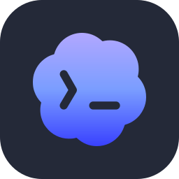

### Hi, I'm Grega 👋

**Fully agentic.** I don't write much code anymore; I run agents that do, around the clock. 
**Token maxing:** every account, every hour, nothing left on the table. 
Ljubljana, Slovenia · EE student, started on microcontrollers. 
Powered by love, programming and mountains ❤️💻🏔️

  &nbsp;
  

<picture>
  <source media="(prefers-color-scheme: dark)" srcset="https://streak-stats.demolab.com?user=grega-rotar&theme=dark&hide_border=true&background=00000000" />
  
</picture>

[X](https://x.com/grega_rotar) · [Instagram](https://instagram.com/grotar123)
